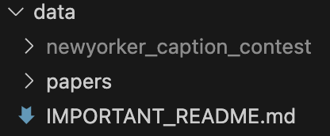

 
# IMPORTANT: DATASET PLACEMENT
Download the dataset (see URL below), unzip/extract it, and place the resulting folder inside the ```data/``` directory.
The folder name MUST remain exactly: **```newyorker_caption_contest```**

Do NOT rename this folder. If you change the name, the dataset may get added or saved in the GitHub repo and code expecting data/newyorker_caption_contest will fail.


Your ```data/``` folder should look like this:
```
data/
├── IMPORTANT_README.md
├── newyorker_caption_contest
│   ├── contests.json
│   ├── data/
│   │   └── ...
│   └── images/
│       └── ...
└── papers
    ├── Do Androids Laugh at Electric Sheep - Paper.pdf
    └── Humor in AI - Paper.pdf
```
In VS Code the folder ```newyorker_caption_contest``` should be grayed out showing that git will not track it, like shown below:




## Dataset Download URL
[https://drive.google.com/file/d/1Es1XmglK5isHZuLiO2RDQfc1tYrDYzXz/view?usp=sharing](https://drive.google.com/file/d/1Es1XmglK5isHZuLiO2RDQfc1tYrDYzXz/view?usp=sharing)

### Reference
Zhang, J.*, Jain, L.*, Guo, Y.*, Chen, J., Zhou, K. L., Suresh, S., ... & Nowak, R. (2024). Humor in AI: Massive Scale Crowd-Sourced Preferences and Benchmarks for Cartoon Captioning. arXiv preprint arXiv:2406.10522.

## Relevant papers
- [Humor in AI (PDF)](papers/Humor%20in%20AI%20-%20Paper.pdf) --> [URL to article](https://arxiv.org/abs/2406.10522)
- [Do Androids Laugh at Electric Sheep (PDF)](papers/Do%20Androids%20Laugh%20at%20Electric%20Sheep%20-%20Paper.pdf) --> [URL to article](https://aclanthology.org/2023.acl-long.41/)

## Other related links
- [https://nextml.github.io/caption-contest-data/](https://nextml.github.io/caption-contest-data/)
- [https://huggingface.co/datasets/jmhessel/newyorker_caption_contest](https://huggingface.co/datasets/jmhessel/newyorker_caption_contest)